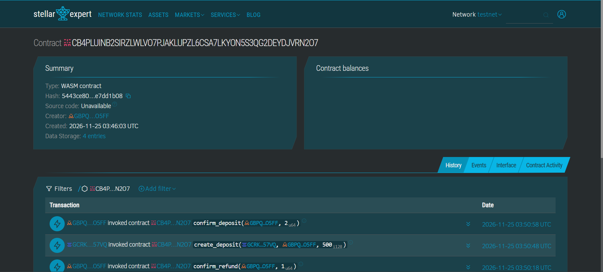

# Project Title

RentDeposit

# Project Description

RentDeposit is a Soroban smart contract on the Stellar network designed to track room rental deposits, move-out deductions with reasons, and mutual confirmations between a landlord and a student. Each deposit record follows a strict lifecycle (`Created` -> `DepositConfirmed` -> `Deducted` -> `RefundConfirmed`) and is stored in persistent contract storage.

# Project Vision

To reduce disputes between landlords and students at move-out by recording deposit amounts, itemized deduction amounts and reasons, and both parties' step-by-step confirmations transparently on-chain.

# Key Features

- **Create Deposit Record (`create_deposit`)**: Allows an authenticated landlord to create a new deposit record (`id`, `landlord`, `student`, positive `deposit`, `deduction = 0`, empty `reason`, and `status = Created`) in persistent storage.
- **Confirm Deposit Payment (`confirm_deposit`)**: Allows the assigned student to authenticate and confirm the deposit when the record is in `Created` status, transitioning it to `DepositConfirmed`.
- **Record Move-Out Deduction (`record_deduction`)**: Allows the assigned landlord to authenticate and record a non-negative `deduction` (not exceeding `deposit`) along with a `reason` when the record is in `DepositConfirmed` status, transitioning it to `Deducted`.
- **Confirm Refund (`confirm_refund`)**: Allows the assigned student to authenticate when the record is in `Deducted` status, transitioning it to `RefundConfirmed` and returning `deposit - deduction`.
- **Read Deposit Record (`get_deposit`)**: Retrieves and returns the stored `DepositRecord` for a given `id`, or returns `RecordNotFound` if no record exists.
- **Validation & Error Handling**: Enforces role authorization (`require_auth` and matching `landlord`/`student` addresses), positive deposit amounts, non-negative deductions within the deposit limit, sequential status transitions, and explicit `Error` codes without `panic!`, `unwrap()`, or `expect()`.

# Usage Instructions

### Prerequisites

- Stellar CLI (`stellar`) installed and configured for `testnet`
- Two funded testnet accounts/identities (for example, `landlord` and `student`)
- Contract built and deployed to `testnet` with an alias such as `my-contract`

### Step-by-Step Workflow (PowerShell)

1. **Create a deposit record (Landlord)**

```powershell
stellar contract invoke --id my-contract --source-account landlord --network testnet -- create_deposit --landlord landlord --student student --deposit 1000
```

2. **Confirm the deposit was paid (Student)**

```powershell
stellar contract invoke --id my-contract --source-account student --network testnet -- confirm_deposit --student student --id 1
```

3. **Record a deduction and reason at move-out (Landlord)**

```powershell
stellar contract invoke --id my-contract --source-account landlord --network testnet -- record_deduction --landlord landlord --id 1 --deduction 200 --reason "Broken glass door"
```

4. **Confirm the refund amount (Student)**

```powershell
stellar contract invoke --id my-contract --source-account student --network testnet -- confirm_refund --student student --id 1
```

5. **Read a deposit record**

```powershell
stellar contract invoke --id my-contract --source-account student --network testnet -- get_deposit --id 1
```

# Future Scope

- Automated or on-chain fund custody, token transfers, or escrow payouts (the current contract records amounts and confirmations only and does not hold or transfer tokens).
- Multi-item deduction breakdowns or dispute resolution / arbitration workflows when a student disagrees with a deduction.
- Editing or updating a deposit record or deduction before confirmation, or listing/querying records by landlord or student address.
- Frontend web or mobile interface for students and landlords to interact with the contract without using the CLI.

# Technology Stack

- **Smart Contract Language**: Rust (`#![no_std]`)
- **Smart Contract SDK**: `soroban-sdk`
- **Network & Tooling**: Stellar Network (`testnet`), Stellar CLI (`stellar contract invoke`)

# Contract Detail

Contract ID: CB4PLUINB2SIRZLWLVO7PJAKLUPZL6CSA7LKYON5S3QG2DEYDJVRN2O7
Deployer:

